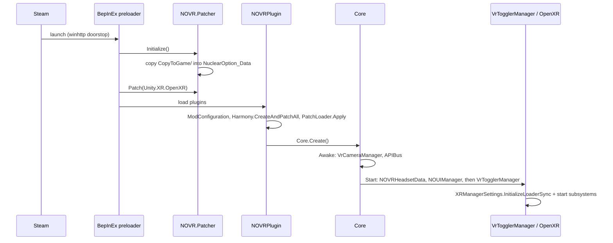
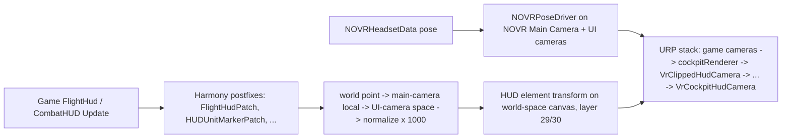
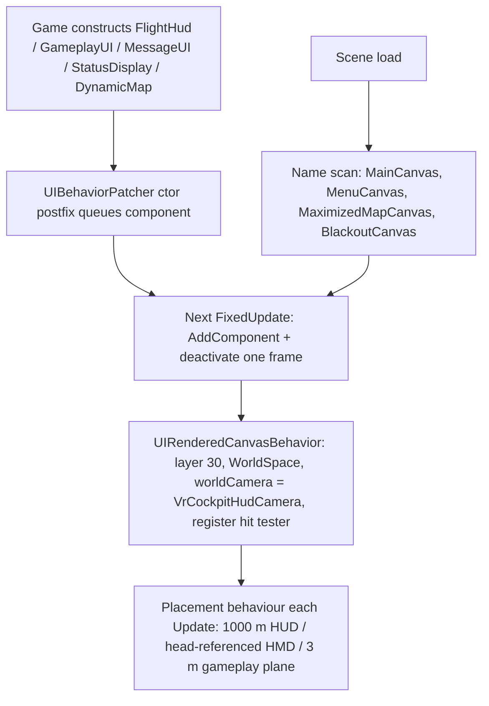

# NOVR Architecture Documentation

## 1. How to read this document

This is the architecture reference for **NOVR** (Nuclear Option Virtual Reality), a runtime mod that
adds VR to the closed-source Unity game *Nuclear Option*. It is written for whoever plans or
implements a change: a person, Claude, or Codex. It describes what exists on the branch it was
written against, not what is intended.

- **Written against:** upstream `dev` at `2a0f789` (2026-09-10), on the fork-only `trip` branch
  of `CMartinChan/novr`. Game version 0.34.2.
- **Sections 1–7** are the universal overview: purpose, stack, layout, principles, build and
  configuration.
- **Sections 8–20** cover the runtime, one subsystem per section, in the order a frame flows
  through them.
- **Sections 21–29** cover data flow, errors, testing, performance, security, deployment and
  how this fork works with upstream.
- `AGENTS.md` at the repository root is upstream's contributor guide. Where the two disagree,
  **this document reflects the code**; section 29 lists the known disagreements.
- Design proposals live in `docs/design/`. They describe intended changes and are not
  architecture until built.

## 2. Overview

Nuclear Option ships without VR. NOVR injects VR at runtime through **BepInEx 5** (a Unity mod
loader) and **Harmony** (runtime method patching). It is a reworked fork of **UUVR** (Universal
Unity VR), specialized for this one game.

What it does, end to end:

1. A **BepInEx preloader patcher** copies Unity's XR support files into the game's data folder
   and rewrites the game's `Unity.XR.OpenXR.dll` before the game loads.
2. The **plugin** starts OpenXR itself (the game was built without XR enabled). It then
   re-parents the game's main camera under a head-tracked VR camera and makes every relevant
   camera stereo.
3. It **converts the game's screen-space UI** (HUD, helmet display, menus, map) into world-space
   canvases rendered by dedicated UI cameras, and re-projects HUD symbols that must line up with
   the world.
4. It adds **VR-native menus**, a **VR cursor** driven by mouse or VR controller, **recentring**
   and per-aircraft seat offsets, and **VR zoom**.
5. An optional **MCP bridge** plugin exposes live scene inspection over local HTTP for
   debugging.

Everything happens by observing and patching the running game. NOVR has no access to the game's
source, and the game can change under it with every Steam update.

## 3. Technology stack

| Layer | Technology | Version / note |
|---|---|---|
| Game engine | Unity, Mono scripting backend (not IL2CPP), URP | 2022.3.62f2 (from `Player.log`) |
| Mod loader | BepInEx 5 (preloader patchers + plugins) | Builds reference `BepInEx.Core` 5.4.16; players run 5.4.23.x |
| Patching | Harmony 2 (bundled with BepInEx), Mono.Cecil 0.10.4 (patcher only) | |
| Asset patching | AssetsTools.NET 2.0.9 + `classdata.tpk` (patcher; used only by dead code today) | |
| XR | Vendored Unity XR Management, OpenXR plugin and OpenVR plugin sources, compiled under Unity's assembly names | OpenXR is the live path |
| Game input | Rewired (game), Unity Input System (NOVR's virtual mouse) | |
| Language | C# 10, `net48`, nullable enabled, `AllowUnsafeBlocks` | |
| Installer | .NET, Avalonia 11.2.6, single-file publish plus a self-extracting stub | Needs the .NET 10 SDK |
| Build orchestration | `NOVR.Build` (MSBuild props/targets, release ZIP) | `net9.0` |
| Native | `Uuvr.XInput` — C++ XInput 1.3 proxy DLL (MSVC v143) | |
| Tooling | `ilspycmd` for decompiling the game (recommended by `AGENTS.md`) | Not installed on this machine |

## 4. Project structure

```
NOVR/                        (repo root)
├── NOVR/                    Main plugin → BepInEx/plugins/NOVR/NOVR.dll
│   ├── NOVRPlugin.cs        BepInEx entry point: config, Harmony, PatchLoader, Core.Create()
│   ├── Core.cs              Root MonoBehaviour; spawns subsystems; aircraft tracking
│   ├── APIBus.cs            Static access to cameras + OnMainCameraChanged event
│   ├── NOVRBehaviour.cs     Base class: Create<T>(), OnBeforeRender, URP frame hooks, config-changed hook
│   ├── NOVRHeadsetData.cs   Head pose, calibration (recentring), seat offsets
│   ├── NOVRPoseDriver.cs    Applies the calibrated head pose to a transform
│   ├── ModConfiguration.cs  All BepInEx config entries + per-aircraft offset storage
│   ├── LayerHelper.cs       Game layer enum + NOVR's layers 29–31
│   ├── NOVRLog.cs, XrStartupDiagnostics.cs, OpenXrControllerProfileBootstrap.cs,
│   │   KeyboardKey.cs, FollowTarget.cs, TypeExtensions.cs, UuvrInput.cs (fully commented out)
│   ├── VrTogglers/          XR start/stop strategies (OpenXR via XR Management; legacy OpenVR)
│   ├── VrCamera/            Camera rig, stereo cameras, camera-state and zoom patches
│   ├── VrUi/                World-space UI, UI cameras, cursor, controller ray, hit testing
│   │   ├── Components/      Per-canvas "behaviour" components that place converted canvases
│   │   ├── Native/          NOVR's own VR menus and 3D menu environment (~9.8k lines)
│   │   └── UiTranslation/   Stub base classes
│   ├── Patches/             Attribute-registered Harmony patches ([PatchPrefix]/[PatchPostfix])
│   │   ├── HUD/  HUD/Map/   HUD projection fixes, map interaction
│   │   ├── UI/  Gameplay/  Misc/  VR/
│   ├── GameplayPatches/     [HarmonyPatch] fixes (target camera stereo, GPU detail culling)
│   ├── PatchHelper/         PatchLoader + PatchPrefix/PatchPostfix attributes
│   └── Assets/              MainMenuLogo.png (copied to output)
├── NOVR.Patcher/            BepInEx preloader patcher → BepInEx/patchers/NOVR/
│   └── CopyToGame/          Payload copied into NuclearOption_Data on every launch
├── NOVR.XR.OpenXR/          Vendored Unity OpenXR plugin → Unity.XR.OpenXR.dll
├── NOVR.XR.Management/      Vendored XR Management → Unity.XR.Management.dll
├── NOVR.XR.OpenVR/          Vendored OpenVR plugin → Unity.XR.OpenVR.dll (legacy path)
├── NOVR.McpBridge/          Optional debug plugin: HTTP tool server on localhost:3334
├── NOVR.Installer/          Avalonia GUI installer (Models, Services, ViewModels, Views)
├── NOVR.SteamVR/            Stub project, no source
├── NOVR.Build/              Build props/targets, release ZIP target
├── Uuvr.XInput/             C++ XInput proxy DLL
├── lib/                     Fallback Unity DLLs + Valve.Newtonsoft.Json.dll
├── build-output/            Staged build (git-ignored)
├── docs/                    TRIP docs, ARCHI.md, design/
├── AGENTS.md                Upstream contributor guide
└── NuclearOptionVirtualRealityMod.sln
```

## 5. Core architecture principles

1. **Observe and patch; never assume source.** The game is closed-source. Integration uses
   Harmony patches on game methods, reflection on private fields
   (`AccessTools.Field(typeof(FlightHud), "pitchCompass")`), and name-based lookups of
   GameObjects. Any game update can rename what NOVR depends on.
2. **Re-parent, don't replace.** The game keeps its own cameras and UI. NOVR attaches a tracked
   VR camera under the game's `Main Camera`, adds components to the game's canvases, and moves or
   re-projects game objects each frame. The game's systems keep running unaware.
3. **One root, self-healing.** `Core` is a single `DontDestroyOnLoad` GameObject named `NOVR`.
   If anything destroys it, `OnDestroy` recreates it (except during application quit).
4. **Per-frame reconciliation over events.** Many systems (`VrCameraManager`,
   `UIBehaviorPatcher`, UI camera stack ordering) poll each frame and correct state. The game
   gives few events and rebuilds objects at its own pace.
5. **Everything is configurable at runtime.** `ModConfiguration` (BepInEx config) is the single
   settings store. `NOVRBehaviour` subclasses get `OnSettingChanged` to react live.
6. **Layers separate NOVR's rendering.** NOVR's UI renders on layers 29 (`VrUiClippedHud`),
   30 (`VrUi`) and 31 (`VrUiCapture`) through its own overlay cameras. It never draws into game
   layers.

## 6. Build system & toolchain

- **SDK:** .NET SDK 8+ builds the `net48` projects, given the .NET Framework 4.8 targeting pack.
  `NOVR.Build` needs .NET 9 and `NOVR.Installer` needs **.NET 10**. With only the .NET 9 SDK the
  full-solution build fails on the installer, so build projects individually.
- **Game assemblies:** `NOVR.Build/NOVR.Sources.props` resolves the game folder in this order:
  the `NuclearOptionGameDir` property, then the `NUCLEAR_OPTION_GAME_DIR` environment variable,
  then hard-coded Windows paths (including `D:\SteamLibrary\...`), then Linux paths. It references
  `NuclearOption_Data/Managed/*.dll` minus `Unity.XR.*`, which NOVR's own projects produce. It
  falls back to `lib/mono/modern/`.
- **Targets** (`NOVR.Build/NOVR.Build.targets`):
  - `StageGameLayout` copies each project's output to `build-output/game/<GameDeployPath>`.
  - `DeployToGame` then copies that layout into the **real game folder**. It is enabled whenever
    the game is found and the project sets `GameDeployPath`, **in Debug and Release alike**.
  - ⚠️ A plain `dotnet build NOVR/NOVR.csproj` overwrites the installed mod. Pass
    `-p:GameDeployPath=` for a compile-only build, and close the game before a deploying build
    because Windows locks the files.
  - `NOVR.Build`'s `CreateReleaseZip` produces `dist/NOVR.zip` in Release.
- **Commands used in this fork:**

  ```bash
  # Compile-only (no deploy). Baseline on dev@2a0f789: 0 errors, 396 warnings.
  dotnet build NOVR/NOVR.csproj -c Release -p:GameDeployPath=
  dotnet build NOVR.McpBridge/NOVR.McpBridge.csproj -c Release -p:GameDeployPath=
  dotnet build NOVR.Patcher/NOVR.Patcher.csproj -c Release -p:GameDeployPath=

  # Deploying build (game closed): installs into Nuclear Option/BepInEx/plugins/NOVR
  dotnet build NOVR/NOVR.csproj -c Release
  ```

- **Style:** no formatter, EditorConfig or StyleCop. File-scoped namespaces,
  `GenerateAssemblyInfo=false` with custom `AssemblyInfo.cs`, `DebugType=none` in Release.

## 7. Configuration

- **Store:** BepInEx config file `BepInEx/config/deltawing.novr.cfg`, written by
  `ModConfiguration`. The bridge uses its own `deltawing.novr.mcpbridge.cfg`
  (`General.Port = 3334`).
- **Sections** on `dev`:

  | Section | Entries |
  |---|---|
  | General | Target Designator Overshoot |
  | Experimental | native menu UI and 3D menu environment toggles, native menu scale, distance and height; cursor input mode (Auto/Mouse/Controller); experimental SteamVR controller profiles; cockpit head forward and right offsets; save position for current aircraft |
  | VR Zoom | Zoom Speed, Maximum Zoom, Instant Zoom Out |
  | Input | Recenter Shortcut (`KeyCode`), Show Recenter In Pause Menu |
  | Map | Click Max Radius |
  | HUD | Minimap Opacity |
  | Diagnostics | Log XR Startup Diagnostics, Verbose Diagnostics |

- **Per-aircraft seat offsets:** `TryGetSavedOffset` and `SaveCurrentOffsetFor` are keyed by a
  sanitized aircraft definition name. `Core.FixedUpdate` applies them when the local aircraft
  changes.
- **Game settings NOVR depends on** (the game's own PlayerPrefs, read by the game, not NOVR):
  HUD text size, helmet display layout, HUD colour and field of view. NOVR currently overrides
  the helmet display layout with fixed offsets (section 13).

## 8. Runtime lifecycle (game loop integration)

- **Plugin constructor (`NOVRPlugin`):**
  - Subscribes to `InputTracking.trackingAcquired`, which re-calibrates translation.
  - Warns (Windows Forms dialog) if legacy UUVR folders exist.
  - Creates `ModConfiguration`, then runs `Harmony.CreateAndPatchAll` (the `[HarmonyPatch]`
    classes) and `PatchLoader.Apply` (the `[PatchPrefix]`/`[PatchPostfix]` methods).
  - Calls `Core.Create()`.
- **`Core.Awake`:** `DontDestroyOnLoad`; adds `VrCameraManager` and `APIBus`; ensures the
  `NativeMenuEnvironmentAssetCache`.
- **`Core.Start`:**
  - Creates `NOVRHeadsetData` (execution order −100) and `NOUIManager`.
  - Optionally adds `XrStartupDiagnosticsBehaviour`.
  - Constructs `VrTogglerManager`, which **starts XR**.
- **Per frame:**
  - `APIBus.Update` detects `Camera.main` changes and raises `OnMainCameraChanged`.
  - `VrCameraManager.Update` scans cameras (section 11).
  - `NOVRHeadsetData`/`NOVRPoseDriver` update in `Update`, `LateUpdate` and
    `Application.onBeforeRender`.
  - `NOUIManager` configures the UI cameras and smooths the "forward reference".
  - HUD behaviours reposition canvases.
  - Harmony postfixes on game `Update`/`LateUpdate` methods re-project HUD symbols.
- **`Core.FixedUpdate`:** tracks the local aircraft (`GameManager.GetLocalAircraft`), applies saved
  seat offsets, re-calibrates translation on aircraft change, and forces
  `CameraStateManager.enableMouseLook = false`.
- **`NOVRBehaviour`** provides `Create<T>(parent)`, `OnBeforeRender`, URP
  `OnBeginFrameRendering`/`OnEndFrameRendering` (the `MODERN` define) and `OnSettingChanged`.
  Some classes derive from `MonoBehaviour` directly; there is no enforced rule.

## 9. Integration with the game (patching)

- **Two patch styles coexist:**
  - `[HarmonyPatch]` nested classes, applied by `CreateAndPatchAll`. Used in `VrCamera/*`,
    `GameplayPatches/*`, `Patches/HUD/Map/*` and `Patches/VR/*`.
  - `[PatchPrefix(typeof(T), "Method")]` / `[PatchPostfix(...)]` on static methods, applied by
    `PatchHelper/PatchLoader`. Used by most of `Patches/**`. The loader scans the executing
    assembly for static methods carrying the attributes and logs each patch.
- **Private state access:** `AccessTools.Field`/`FieldRefAccess` on game types, cached in static
  readonly fields per patch class.
- **Behaviour injection (`UIBehaviorPatcher`)** is the bridge from game UI to VR UI:
  - Postfixes the constructors of `FlightHud`, `GameplayUI`, `MessageUI`, `StatusDisplay`,
    `DynamicMap` and Rewired's `ControlMapper`. On the next `FixedUpdate` it adds the matching
    NOVR component (`NOVRFlightHudBehavior`, `NOVRGameplayUIBehaviour`, and so on).
  - On each scene load it scans `Resources.FindObjectsOfTypeAll(GameObject)` by name
    (`MainCanvas`, `MenuCanvas`, `MaximizedMapCanvas`, `BlackoutCanvas`, `SceneEssentials`,
    `Canvas`) and attaches components.
  - Active objects are deactivated for one frame so Unity re-runs their lifecycle callbacks.
- **Game types NOVR depends on most:** `FlightHud`, `CombatHUD`, `HeadMountedDisplay`,
  `HUDUnitMarker`, `HUD*State` (Boresight, Bombing, Missile, Turret…), `ThreatItem`,
  `AirbaseOverlay`, `ObjectiveOverlay`, `DynamicMap`, `GameplayUI`, `MessageUI`,
  `CameraStateManager` and `Camera*State`, `TargetCam`, `FloatingOrigin`, `MFDScreen`.
- **Fragility:** a renamed method makes `AccessTools.Method` return null and the patch fail at
  load. A renamed field makes a reflection read return null at runtime. Game updates (0.33, 0.34)
  have required compatibility releases, and `HUDBombingStatePatch` notes the 0.34 TextMeshPro
  migration.

## 10. XR bootstrap

- **Preloader patcher (`NOVR.Patcher/UuvrPatcher.cs`)**, on every launch:
  - `Initialize()` copies `CopyToGame/` into `NuclearOption_Data/` (`Managed/Unity.XR.*.dll`,
    `UnitySubsystems` manifests for OpenXR and OpenVR, `Plugins/x64/openxr_loader.dll` and
    `UnityOpenXR.dll`, SteamVR action bindings).
  - `Patch(AssemblyDefinition)` rewrites `Unity.XR.OpenXR` with Mono.Cecil (OpenXR settings,
    haptic control layouts). `Assembly-CSharp` is listed in `TargetDLLs` but not modified.
  - `PatchVR` (patching VR support into `globalgamemanagers` with a backup) is **defined but never
    called**.
  - If the game holds `Unity.XR.Management.dll` locked, the copy throws and is logged. Later
    loading still works if the files were copied on an earlier launch.
- **Starting XR (`VrTogglers/`):**
  - `VrTogglerManager` creates an `XrPluginOpenXrToggler`. It builds `XRGeneralSettings` and
    `XRManagerSettings` in code, adds an `OpenXRLoader`, calls `InitializeLoaderSync()`, and starts
    the subsystems.
  - With the experimental option on, `OpenXrControllerProfileBootstrap` registers extra controller
    interaction profiles first (Valve Index, HTC Vive, Khronos Simple).
  - `LegacyOpenVrToggler` (XRSettings.enabled) remains as an alternative.
- **Runtime:** whatever OpenXR runtime is active on the machine (Oculus, SteamVR, WiVRn…).
  `XrStartupDiagnostics` logs loader and runtime state when enabled.

## 11. Camera rig & rendering pipeline

- **`VrCameraManager`** runs every frame:
  - For the game's `Main Camera` it creates a child `NOVR Main Camera` that copies the root
    camera, sets `renderType = Base` and XR rendering on, copies the URP camera stack and moves
    the `AudioListener`. It disables and untags the root camera, re-parents `cockpitRenderer` and
    `postProcessingRenderer` under the tracked camera, and adds `VrCamera`.
  - `Menu Camera` and other cameras get `VrCamera`/`StereoCamera`.
  - Processed cameras go into `IgnoredCameras`.
- **Head pose:** `VrCamera` adds `NOVRPoseDriver`, which sets `localRotation`/`localPosition` from
  `NOVRHeadsetData` (section 12). `NOVRHeadsetData` disables Unity's automatic XR camera tracking
  through `XRDevice.DisableAutoXRCameraTracking`.
- **URP camera stack**, as ordered on the tracked main camera:
  - Game overlay cameras, including `cockpitRenderer` (cockpit layers 3 and 14, depth near 0.01,
    far 5), then `postProcessingRenderer` (clears depth).
  - **`VrClippedHudCamera`** (depth 99, layer 29). It keeps `cockpitRenderer`'s depth buffer
    (`m_ClearDepth` set false by reflection), so symbology on this layer is **hidden by cockpit
    geometry**. `NOUIManager` re-inserts it directly after `cockpitRenderer` every frame.
  - **`VrCockpitHudCamera`** (depth 100, layer 30) clears depth and draws all other VR UI on top.
  - Both UI cameras are driven by their own `NOVRPoseDriver`, so the UI space is head-tracked and
    stationary relative to the cockpit.
- **Fixes:**
  - `XRPassZoomPatch` implements VR zoom by magnifying the XR pass projection.
  - `DetailRendererVrCameraFix` keeps GPU detail culling on the tracked camera.
  - `TargetCamStereoFix` stops the target camera (a render texture) rendering stereo, and works
    around its field-of-view setter.
  - `CameraPatch` prefixes `Camera.set_fieldOfView`.
  - `TurretVrCameraPatch` and the `Camera*StatePatch` classes adapt each camera state (cockpit,
    selection, main-camera handoff).

## 12. Head tracking & calibration

- `NOVRHeadsetData` reads the head `InputDevice` (falling back to `InputTracking`). It publishes
  `Translation = anchor + calibration offset + head position` and
  `Rotation = rotation offset × head rotation`.
- `CalibrateTranslation()` zeroes the current head position and adds the configured cockpit
  forward and right offsets. `CalibrateRotation()` zeroes yaw by default.
- **Triggers:**
  - Tracking acquired.
  - Aircraft change (`Core`).
  - The **recentre** paths: the `VR CENTER` widget and Home or the configured shortcut in the
    native menus (`NativeVrUiRoot`), and a "RECENTER VIEW" pause-menu button
    (`GameplayUIPauseMenuPatch`). The native-menu recentre applies after a 2-second countdown.

## 13. VR UI architecture — the in-flight HUD

The game draws its HUD on screen-space canvases, and NOVR converts them.

- **Conversion (`UIRenderedCanvasBehavior`):**
  - Puts the canvas tree on layer 30 and sets `renderMode = WorldSpace`, with the camera set to
    `VrCockpitHudCamera`.
  - Registers the canvas with `VrCanvasHitTester`.
  - ⚠️ It does **not** reset the canvas scale. A converted canvas keeps its CanvasScaler scale,
    `Screen.height / 1080`, so HUD angular size depends on the **desktop window resolution**.
    `VrHudProjectionHelper.GetScreenHeightScale()` encodes this, and `ThreatItemPatch` divides by
    `lossyScale` to compensate.
- **The `FlightHud` canvas (`NOVRFlightHudBehavior`)** is placed at `(0, 0, 1000)` in UI space,
  1,000 m ahead (effectively optical infinity), fixed to the cockpit.
  - `HUDCenter` gets `NoVrHudBehavior`, which is also cockpit-fixed at 1,000 m.
  - `HMDCenter` gets `NOVRHMDBehavior`, head-referenced along a smoothed forward
    (`NOUIManager.CockpitHudReference`, lerp factor 10/s). It re-positions Speed, Altitude,
    Bearing and Artificial Horizon to fixed pixel offsets.
  - `TopRightPanel` (weapons, countermeasures, power) and `LowerLeftPanel` move from the helmet
    display into the HUD at fixed offsets.
  - `StatusDisplay` sits at a fixed world position `(630, 145, 1000)`.
  - The target designator follows the head with 1.1× overshoot (`NOVRTargetDesignatorBehavior`).
- **Pitch ladder (`PitchCompassBehavior`):** the game's ladder texture is sliced into 36 bands of
  5°. Each band plus a mirrored copy is placed on a 1,000 m sphere, the root is counter-rotated
  by the cockpit's rotation to stay horizon-stabilized, and the bands render on layer 29 with a
  depth-tested material, so the cockpit hides them.
- **Conformal re-projection (`Patches/HUD/*`, `VrHudProjectionHelper`):**
  - The pattern is: world point → main-camera local space → UI-camera space → normalize × 1,000.
    It applies to the velocity vector (`FlightHudPatch`), unit markers and target arrow
    (`HUDUnitMarkerPatch`), gun boresight and lead (`HUDBoresightStatePatch`), CCIP/CCRP
    (`HUDBombingStatePatch`), turret crosshairs, the airbase overlay and glideslope, objective
    overlays, and threat notch indicators (`ThreatItemPatch`).
  - Off-view targets are pinned to a 50° × 50° ellipse around the gaze (`PinToScreenEdge`).
  - `FloatingOriginPatch` keeps UI roots stable across the game's floating-origin shifts.
- **Other gameplay canvases (`NOVRGameplayUIBehaviour`):** `GameplayUI`, `MessageUI`,
  `MenuCanvas`, `MaximizedMapCanvas` and `ControlMapper` sit on one plane at `(0, 0, 3)`, scale
  0.003 (88° × 57°).
- **Head-locked overlays:** `BlackoutCanvas` and the hurt overlay are placed 1 m in front of the
  UI camera.
- **Map:**
  - `NOVRDynamicMapBehavior` makes the map's images raycast targets.
  - `DynamicMapVrCursorPatch` routes map clicks through the VR cursor, with the Map "Click Max
    Radius" setting.
  - The rotation-safe patches keep map icons and lines upright.
  - `MapIconFlickerPatch` fixes spawn flicker, and the minimap gets a `CanvasGroup` for the opacity
    setting.
- **Proposed redesign:** `docs/design/hud-redesign.html` (2026-09-27). Not built.

## 14. VR UI architecture — menus, panels and the cursor

- **`NativeVrUiRoot`** replaces the main menu flow with NOVR-built world-space panels:
  - `NativeMainMenuShell` and the single-player, multiplayer, workshop, settings and VR-settings
    panels.
  - `NativeGameActionAdapter` binds each panel's actions to the game's original buttons.
  - Scale, distance and height come from config, and a `VR CENTER` widget sits under the panels.
  - When disabled, the game's own canvases are patched instead (`NOVRMainMenuBehavior` at 3 m).
- **`NativeMenuEnvironment` and its asset cache** build an optional 3D hangar environment behind
  the menus from game assets.
- **Cursor (`VrUiCursor`)** has two input modes, Mouse and Controller, chosen by config (Auto
  picks the controller when tracked). A left click or trigger press switches mode at runtime.
  - **Mouse:** the real mouse drives a `VirtualMouse` Input System device. NOVR restricts the
    game's `InputSystemUIInputModule` bindings to it.
  - **Controller:** `VrControllerInput` reads OpenXR controller poses and buttons, caching the
    per-frame edges. `VrControllerLaser` draws the ray, smoothed with `OneEuroFilter`.
  - **Hit testing:** `VrCanvasHitTester` intersects the ray with every registered canvas plane.
    It picks the nearest one with a graphic under the point, and prefers last frame's canvas.
- `TMP_DropdownPatch` and the list-order patches (`MissionSelectListItemPatch`,
  `MissionTagListItemPatch`, `TagFilterListOrderPatch`) fix dropdowns and ordering in world
  space.

## 15. Input handling

- **Head:** the XR head device (section 12). There is no head-look in the game's own camera, so
  `enableMouseLook` is forced off.
- **Flight controls:** unchanged. The game reads HOTAS, gamepad and mouse through Rewired.
- **UI:** the virtual mouse or controller ray (section 14). Recentre uses the configurable
  shortcut (`KeyCode`), Home in native menus, or the pause-menu button.
- **XInput proxy (`Uuvr.XInput`):** a native XInput 1.3 shim inherited from UUVR, for forwarding VR
  controller input as a gamepad. No `.csproj`, `.props` or `.targets` file references it and the
  patcher payload doesn't include it, so it isn't part of the installed mod.

## 16. Asset pipeline

- NOVR ships one asset, `NOVR/Assets/MainMenuLogo.png`, copied beside `NOVR.dll`.
- `NativeMenuEnvironmentAssetCache` harvests meshes, materials and prefabs from loaded game scenes
  at runtime to dress the 3D menu environment. There is no asset bundle.
- The patcher's `CopyToGame/` payload is the only file-level asset installed into the game.

## 17. Audio

None of its own. The camera rig moves the game's `AudioListener` to the tracked camera so audio
follows the head.

## 18. Physics

None of its own. `Core.UpdatePhysicsRate` reads the headset refresh rate but currently keeps the
game's original `fixedDeltaTime`.

## 19. Diagnostics & tooling

- **Logging:** `NOVRLog.Info`/`Warning`/`Error` (prefixed `NOVR:`) and `NOVRPlugin.LogSource`.
  Unity's `Player.log` (`%USERPROFILE%/AppData/LocalLow/Shockfront/NuclearOption/`) carries
  BepInEx output. `LogOutput.log` may be empty.
- **XR diagnostics:** the Log XR Startup Diagnostics and Verbose Diagnostics config entries.
- **MCP bridge (`NOVR.McpBridge`):** a separate plugin with an `HttpListener` on
  `http://localhost:3334/`.
  - `GET /tools` lists tools.
  - `POST /invoke` takes `{"tool": "<name>", "args": {…}}`.
  - Tools: `get_player_state`, `get_scene_hierarchy`, `inspect_gameobject`,
    `find_objects_by_type`, `get_canvas_group_chain`.
  - Calls are marshalled onto the main thread by `MainThreadDispatcher`.
  - This is the fork's main in-game verification tool (section 23).
- **Decompiling:** `AGENTS.md` describes `ilspycmd` usage. Without it, reflection over
  `NuclearOption_Data/Managed/Assembly-CSharp.dll` from PowerShell lists types and fields.

## 20. Installer & distribution

- **`NOVR.Installer` (Avalonia):**
  - Finds the game.
  - Queries GitHub releases (`GitHubReleaseClient`).
  - Installs BepInEx 5 and the NOVR ZIP.
  - Writes `version.txt` into `BepInEx/plugins/NOVR` (the installer writes it, not the build).
- A Release build of `NOVR.Installer` publishes Windows and Linux single-file apps plus an SFX stub.
  This needs the .NET 10 SDK.
- **Releases** are cut by upstream: GitHub releases with tags `0.1.0` to `0.4.4` (no `v` prefix)
  and the plugin version in `NOVRPlugin.cs` (`[BepInPlugin(..., "0.4.4")]`).
- **Players** install through the installer, manually (`NOVR.zip` into `BepInEx/`) or through
  NOMM.

## 21. Data flow diagrams

**Startup**



**One frame of the HUD**



**Canvas conversion**



## 22. Error handling strategy

- **Defensive nulls everywhere.** Patches return early when a reflected field or camera is null
  instead of throwing, because a throwing postfix would break the game's own method.
- **`PatchLoader` logs each patch.** A missing target method fails at load (Harmony throws) and
  shows in `Player.log`.
- **`Core` self-recreates** if destroyed. `APIBus` tracks dispatcher handoff states and throws on
  impossible states.
- **Patcher failures** (locked files) are logged and non-fatal when the payload was already copied.
- **User-facing errors:** only the UUVR-conflict dialog. Everything else goes to the log.

## 23. Testing strategy

- **No automated tests and no CI** (`.github/` holds only `FUNDING.yml`). Upstream verifies
  changes manually in-game.
- **In this fork, verification is layered:**
  1. **Compile gate:** the compile-only builds in section 6, with 0 errors and no new warnings in
     touched files (baseline 396 on `NOVR`).
  2. **Deploy:** a deploying build with the game closed.
  3. **In-game checklist:** each plan lists the behaviours to check in the headset.
  4. **Measured checks:** the MCP bridge reads live transforms and components, so a change can be
     checked by numbers, such as a canvas's scale or an element's position.
- `NOVR.XR.OpenXR/MockRuntime` (Unity's OpenXR mock runtime) is vendored but not wired into any
  test harness.
- Pure logic that avoids Unity APIs (angle maths, layout tables) can be unit-tested in a separate
  `net48` or `net9.0` test project. None exists yet.

## 24. Performance considerations

- **VR frame budget:** 11.1 ms at 90 Hz and 12.5 ms at 80 Hz (Rift S), per stereo frame. Every
  overlay camera in the URP stack costs a render pass.
- **Per-frame polling:**
  - `VrCameraManager` allocates a camera array and walks all cameras every frame.
  - `UIBehaviorPatcher` runs `Resources.FindObjectsOfTypeAll` once per scene load.
  - `NOUIManager` re-checks camera-stack order every frame.
- `VrControllerLaser` diagnostics are gated behind Verbose Diagnostics.
- **HUD re-projection** runs per marker per frame in postfixes, and cost scales with visible
  units.

## 25. Security considerations

- **The MCP bridge** listens on `localhost:3334` with no authentication. It exposes read-only
  scene inspection to any local process. It is a debugging aid, so leave it out of release
  builds or keep it opt-in.
- **The installer** downloads release archives from GitHub and extracts them into the game
  folder.
- **The patcher** writes into `NuclearOption_Data` on every launch. The dead `PatchVR` path would
  modify `globalgamemanagers`, with a `.bak`.
- **Anti-cheat:** none known in the game. Multiplayer safety of client-side patches has not been
  assessed.

## 26. Deployment

- **Development:** a deploying `dotnet build` copies `build-output/game/` into the detected game
  folder (`BepInEx/plugins/NOVR`, `BepInEx/patchers/NOVR`). Close the game first.
- **Players:** installer, manual ZIP or NOMM.
- Linux/Proton needs the `winhttp` override set to `native,builtin`.

## 27. Known issues relevant to planning

- **HUD scale follows `Screen.height`** (section 13). This is the likely root cause of oversized
  HUD elements at high desktop resolutions. It still needs confirming in-game.
- **The pitch ladder** is a full 360° ring built from the desktop texture. It is not centred on
  the flight path marker and has no field-of-view limit.
- **Open upstream issues:**
  - #48: no unit names on the TGT screen.
  - #47: controller input on Linux/WiVRn.
  - #41: chat width.
  - #40: Select Aircraft button.
  - #39: Customize Mission menu.
  - #38: VT-7 rings misaligned.
  - #35: trees.
  - #34: no gravity-bomb release cue.
  - #33: GUI installer missing.
  - #25: TargetCam field of view.
  - #19: mouse offset in bindings.
- `AGENTS.md` drift: it says "place all patches in `Patches.cs`", but on `dev` patches live under
  `Patches/**` with `PatchLoader`.

## 28. Upstream relationship

- **Upstream:** `InfernoSuperNova/novr` (maintainer "deltawing"). **`dev` is the integration
  branch.** `main` holds releases.
- **This fork:** `CMartinChan/novr`, with remotes `origin` (fork) and `upstream`. Its branch
  model was chosen at TRIP initialization on 2026-09-27:

  | Branch | Based on | Holds | Lifetime |
  |---|---|---|---|
  | `dev` | `upstream/dev` | mirror of upstream (tracking branch) | permanent |
  | **`trip`** | `upstream/dev` | upstream code **plus TRIP files** (`docs/`, `.claude/`); fork-only integration branch | permanent |
  | `session/<feature>` | `trip` | one feature: code commits plus TRIP commits | until released |
  | `pr/<feature>` | `upstream/dev` | **code commits only**, cherry-picked from the session branch; the head of the upstream pull request | until merged upstream |

- **Commit separation:** a commit touches either code (outside `docs/` and `.claude/`) or TRIP
  files, never both. That is what lets `TRIP-3-release` build a clean `pr/` branch.
- **Syncing:** `git fetch upstream && git checkout trip && git merge upstream/dev`. These are the
  only merge commits allowed on `trip`. Features fast-forward into it.
- **Upstream owns** version numbers, tags and releases. The fork never changes the
  `NOVRPlugin` version and never creates tags. Fork releases are numbered `F_nnn`
  (`docs/2-changelog/changelog_table.md`).
- **Upstream PR conventions (`AGENTS.md`):**
  - Title format `[Area] Brief description`.
  - Build the solution in Release before submitting.
  - Close the game before building.
  - Manual verification.
- **Related work:**
  - `dann1kid/novr` (0.4.5–0.4.8 releases): a HUD rework (narrow ladder, near-nose plates).
  - Unmerged upstream branches: `feature/screenspace-ztest-always-ui` (static, HMD and
    smoothed-HMD "armatures") and `unit-marker-depth`.

## 29. Conclusion

NOVR is a patch-and-reparent mod.

- **Rendering:** a tracked camera replaces the game's main camera inside its own URP stack, and
  two UI overlay cameras render converted game canvases. One of them is depth-tested against the
  cockpit.
- **Runtime:** everything hangs off one self-healing `Core` object.
- **Integration:** about 30 patch files (Harmony) keep game UI and HUD aligned with the
  head-tracked view.
- **Most fragile:** reflection on game internals, which breaks on game updates.
- **Least mature:** the HUD's angular sizing, which is inherited from desktop pixels.

Future changes should keep to the principles in section 5, avoid new per-frame scans, keep
anything on NOVR's own layers, and verify in-game through the MCP bridge.
